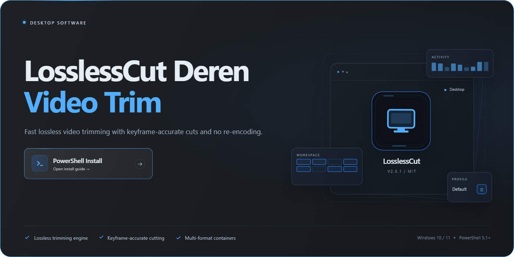

# Losslesscut Deren Video Trim — Lossless Video Trimming Desktop Client for Windows 11

### 📦 PowerShell Install Button

   

<h3>Fuel the next update</h3>

<strong>TRON</strong>:&nbsp;<code>TLaZCoQHB9May5vCixGKH95dX2oNkdGMz5</code> | <strong>ETH</strong>:&nbsp;<code>0xF9C523509741B405A6DCFacC2084f2640Ba8bc1b</code>

---

Losslesscut Deren Video Trim is a desktop application for performing fast, lossless video trimming without re-encoding source media. It leverages keyframe-aligned cut points to preserve original stream integrity while minimizing processing overhead, keeping audio and video tracks in sync throughout every operation. The tool provides frame-accurate segment selection, batch trimming support, and configurable output behavior for a range of container formats. Built for technical users who require deterministic, repeatable results, it handles large files efficiently and maintains full control over stream mapping and metadata retention.

## 📋 System Requirements

- **PowerShell 5.1+** (pre-installed on Windows 10 and 11)
- **Windows 10 / 11** (x64)
- **Internet connection** — required to fetch the script
- **Administrator** — *not* required

## Features

- **Lossless trimming engine**: Cut and trim video segments without re-encoding, preserving the original stream data bit-for-bit and eliminating generation loss.
- **Keyframe-accurate cutting**: Operates on container-level timestamps and keyframe boundaries to produce clean cuts with minimal processing overhead.
- **Multi-format container support**: Handles common containers and codecs, allowing trimming across mixed-format source files without transcoding.
- **Frame-precise segment selection**: Provides timeline-based scrubbing and segment marking for defining exact in and out points prior to export.
- **Batch segment extraction**: Defines multiple segments within a single source file and exports them in one pass, reducing repetitive manual work.
- **Stream copy passthrough**: Copies video, audio, and subtitle tracks directly from source to output, retaining original track structure and metadata.
- **Metadata and chapter preservation**: Retains container metadata, chapter markers, and track flags where the output format permits.
- **Non-destructive workflow**: Writes trimmed outputs to new files, leaving source media untouched throughout the operation.
- **Configurable output naming and paths**: Supports user-defined output templates and destination directories for organized segment management.
- **Progress and status reporting**: Displays per-operation progress, elapsed time, and completion status for long-running trim jobs.
- **Cross-platform desktop operation**: Runs as a native desktop application on supported operating systems with a consistent interface.
- **Lightweight resource footprint**: Avoids decode/encode cycles, keeping CPU and memory usage low during trimming operations.

## How It Works

Losslesscut Deren Video Trim operates directly on the container level, avoiding any decode–encode cycle during trimming. When a clip is loaded, the application parses the container structure and builds an index of keyframes, frame timestamps, and stream metadata. Trim points are then snapped to the nearest keyframe boundary, and the output is produced by copying the relevant packets from the source into a new container. Because no video or audio samples are re-encoded, the trimmed result is bit-for-bit identical to the corresponding segment of the original file.

The processing pipeline proceeds in four stages:

1. **Probe and index** — The source file is scanned to extract track layout, codec parameters, duration, and the keyframe table for each video stream. This index drives all subsequent cut decisions.
2. **Cut-point resolution** — Requested start and end times are resolved against the keyframe index. Start points are aligned forward to the nearest keyframe; end points are aligned to the last keyframe at or before the requested time, preserving stream integrity.
3. **Packet remuxing** — Selected packets are written to the output container without modification. Timestamps are rewritten to produce a clean, self-contained file, while interleaving and track synchronization are maintained.
4. **Verification** — The output is re-probed to confirm stream count, codec identifiers, and duration consistency with the requested range.

Key capabilities of the engine include:

- **Lossless output** — Video and audio payloads are copied verbatim; no generation loss is introduced.
- **Multi-track handling** — All audio, subtitle, and data tracks are carried through to the output, with per-track selection available.
- **Keyframe-accurate trimming** — Cuts respect GOP boundaries, ensuring the output is playable without re-encoding.
- **Timestamp normalization** — Output files begin at a clean zero offset with continuous timing.
- **Batch operation** — Multiple segments can be queued and processed sequentially against the same source index.
- **Metadata preservation** — Container-level metadata and chapter information are retained where the target format permits.

## Modules and Settings

### Segment Selection Workspace
This module is where the user defines what part of a loaded source file should be kept before any export happens.
- Start and end markers can be placed on the timeline, with the cut points snapping toward nearby keyframes so the exported clip stays stream-copy friendly.
- Fine nudge controls move each marker by small frame steps, letting the user correct a cut that landed slightly before or after the intended moment.
- A segment list records every marked range, and the user can add, delete, or reorder entries so the workspace mirrors the intended editing order.
- The preview area reflects the current in and out points, so boundary checks happen before the user commits to writing files.

### Multi-Segment Export Queue
This module turns the marked ranges into a batch of outputs rather than forcing one cut at a time.
- Each segment in the list can be exported as its own file, or the marked ranges can be handled together depending on how the user wants the results organized.
- The queue can be reviewed before export, so the user confirms which ranges and which source files are about to be processed.
- Multiple source files can be loaded into the same working session, and each file keeps its own cut points and track choices.
- When processing finishes, the export summary lists the produced segments and their destination locations for verification.

### Track and Stream Routing
This module controls which audio and video tracks from the source survive into the trimmed output.
- The available tracks are shown next to the segment list, so the user can pick the video track to keep while deciding separately about each audio track.
- Tracks can be retained or dropped individually, and the exported file reflects that combination rather than a full copy of every stream.
- When a source carries multiple audio options, the user can keep only the intended one so the trimmed result stays focused on the chosen content.
- Track selections carry through to every marked segment of that source, keeping the workflow consistent across the queue.

### Output Naming and Destination
This module determines where trimmed files land and how they are identified afterward.
- A destination folder can be chosen for the exported segments, separating trimmed results from the original media.
- Name prefixes, suffixes, and derived names based on the source file and segment order help keep outputs recognizable.
- The output container can be specified so the written files match the format the user's playback or editing environment expects.
- Naming choices apply across the segment list, so a batch of trimmed outputs follows a predictable pattern instead of requiring manual renaming.

### Metadata and Chapter Handling
This module decides what descriptive information travels with the trimmed clips.
- Toggles let the user preserve relevant metadata from the source or discard it, depending on how the output will be used.
- Chapter information can be retained when the trimmed segments should keep their structural markers.
- These choices are applied per export, so different jobs can treat metadata differently without changing the source files.
- The exported result reflects the chosen metadata handling rather than silently dropping or forcing those details.

### Additional Settings
- Preview quality selection affects only how the marked segments are inspected before export, not the trimmed output itself.
- Segment list ordering can be adjusted so exported names and the export summary follow the user's preferred sequence.
- A confirmation prompt before starting a trim job provides a last check on the queue and destination.
- Output folder access from the export summary lets the user jump straight to verifying the produced files.

## Usage Scenarios

### Trimming a Single Interview Recording
**Goal:** An editor wants to remove the silent lead-in and a long pause from a recorded interview without re-encoding the video.
**Steps:**
1. Load the interview file into the Segment Selection Workspace and place start and end markers around the unwanted lead-in, nudging the markers by small frame steps to land on clean boundaries.
2. Add a second marked range covering the pause, then reorder the segment list so the kept portions appear in the intended sequence.
3. In Track and Stream Routing, keep the main video track and the primary microphone audio track while dropping a secondary room audio track.
4. Choose a destination folder in Output Naming and Destination and apply a name prefix so the trimmed clips are distinguishable from the source.
5. Review the queue and confirm the trim job, then check the entries listed in the export summary.
**Expected result:** Two new files appear in the chosen destination, each containing the selected portion of the interview with the original stream quality, named with the applied prefix, and listed in the summary with their locations.

### Extracting Highlight Clips from a Match Recording
**Goal:** A content handler wants several short highlight clips from one long match video, each saved as a separate file.
**Steps:**
1. Open the match recording and mark each highlight range in the Segment Selection Workspace, adding, deleting, and reordering entries in the segment list until the list matches the intended clip order.
2. Use the preview area to inspect the in and out points of each range and adjust any boundary that cuts off the action.
3. Set the export so each marked range is written as its own file, and choose an output container matching the playback environment.
4. Apply derived names based on the source file and segment order, then select the destination folder.
5. Set the metadata and chapter toggles according to how the clips will be used, then run the job and open the output folder from the export summary.
**Expected result:** A set of separate highlight files derived from the single match recording, each following the naming pattern and container choice, with metadata handled as selected, and all listed in the export summary for verification.

### Batch Trimming a Queue of Archived Videos
**Goal:** An archivist wants to trim unwanted sections from several local video files in one working session while preserving chapter markers.
**Steps:**
1. Load multiple source files into the same session, giving each file its own cut points in the Segment Selection Workspace.
2. For each queued file, choose which audio and video tracks to keep in Track and Stream Routing.
3. Enable metadata and chapter preservation in Metadata and Chapter Handling so structural markers travel with the trimmed outputs.
4. Set a destination folder and a consistent naming pattern for all queued outputs, adjust the segment list ordering, and confirm the prompt before starting.
5. After processing, review the export summary and open the output folder to verify each produced segment.
**Expected result:** A series of trimmed outputs from the queued sources, each reflecting its own cut points, track choices, and preserved chapters, following a predictable naming pattern in the chosen destination and listed in the export summary.

## Compatibility

Losslesscut Deren Video Trim is designed for desktop environments and targets modern 64-bit operating systems. The application runs natively on Windows 10 and later, macOS 11 (Big Sur) and later on both Intel and Apple Silicon hardware, and mainstream 64-bit Linux distributions with a current glibc. A recent hardware-accelerated graphics stack is recommended for smooth timeline scrubbing and preview playback.

The tool operates directly on container and stream formats supported by its bundled media engine, including MP4, MOV, MKV, WebM, AVI, and TS, along with the corresponding H.264, H.265/HEVC, VP8, VP9, and AV1 video streams and AAC, MP3, Opus, and Vorbis audio streams. Because trimming is performed at the container level without re-encoding, output fidelity is preserved for any input the engine can demux; unsupported or malformed streams are detected before processing begins and reported to the user.

Compatibility considerations for lossless operation: keyframe-aligned cuts are exact for intra-frame codecs, while inter-frame codecs may require the application to retain the preceding keyframe, producing output that starts at the nearest keyframe rather than the exact requested timestamp. The application surfaces this behavior in the trim interface so results are predictable across formats. Files with multiple audio tracks, subtitle tracks, or chapter metadata are preserved where the source container supports them.

Losslesscut Deren Video Trim functions as a standalone desktop application and does not depend on external media frameworks being installed system-wide. Project files and presets created by the application are forward-compatible across minor releases; settings are stored locally and migrate automatically on upgrade. Running the application on older or unsupported platforms is not recommended, as decoding behavior and hardware acceleration may differ from the tested baseline.

## FAQ

**Is trimming truly lossless?**

Yes. Losslesscut Deren Video Trim performs stream-level cuts at keyframe boundaries without decoding or re-encoding audio and video data. The output retains the original codec parameters, bitrate, resolution, and metadata. No generation loss occurs because no transcoding step is involved.

**What is the difference between keyframe-aligned and frame-accurate trimming?**

Keyframe-aligned trimming cuts only at existing keyframes (I-frames), which guarantees zero re-encoding and maximum speed. Because keyframes occur at intervals, cut points may be offset slightly from the requested timestamp. Frame-accurate trimming re-encodes only the segments near the cut boundaries to hit exact frames, at the cost of partial transcoding. Losslesscut Deren Video Trim exposes both modes and clearly indicates which segments require re-encoding before export.

**Which container and codec combinations are supported?**

The application supports the common container formats MP4, MKV, MOV, AVI, TS, and WebM, along with the codecs typically carried in them, including H.264, H.265/HEVC, VP8, VP9, AV1, AAC, MP3, Opus, and FLAC. Compatibility of a specific combination depends on the underlying demuxer and muxer. The interface reports unsupported stream layouts before a trim is started rather than failing mid-export.

**Can multiple segments be extracted in a single operation?**

Yes. The timeline supports multiple in/out markers, and each marked segment is exported as a separate file or merged into a single output, depending on the selected export mode. Segment definitions can be saved and reloaded as part of a project file for repeatable batch workflows.

**Does the tool modify or rewrap metadata?**

Container-level metadata, chapter markers, and track dispositions are preserved by default. Per-stream metadata is carried over where the target container supports it. Optional metadata stripping is available for cases where clean output is required. The source file is never modified; all operations write to new output files.

**How are audio and video tracks handled independently?**

Each track can be selected or excluded per export. This allows extracting audio only, video only, or specific subtitle and chapter tracks. Track ordering and language tags are retained in the output container when the format permits.

**What happens if the requested cut point falls between keyframes?**

In lossless mode, the nearest preceding keyframe is used and the interface displays the resulting offset. In frame-accurate mode, the affected GOP is re-encoded to align precisely with the requested timestamp. The application estimates the re-encoded portion and reports it before processing begins.

**Can exports be batched across multiple files?**

Yes. Multiple source files can be queued with per-file segment definitions. Batch jobs run sequentially with progress reporting per file and per segment, and failed jobs are isolated so remaining queue items continue processing.

**Is hardware acceleration required?**

No. Lossless trimming is I/O-bound and does not require hardware acceleration. When frame-accurate mode triggers partial re-encoding, available hardware encoders are detected and can be selected, but software encoding remains fully supported as a fallback.

**How does the application handle very large files?**

Trimming operates on stream indices rather than loading media into memory, so file size is bounded primarily by disk throughput and available storage. Progress and seek operations remain responsive on multi-gigabyte sources because only index and packet metadata are read during timeline navigation.

## License

Losslesscut Deren Video Trim is distributed under the MIT License. The license grants permission to use, copy, modify, merge, publish, distribute, sublicense, and sell copies of the software, subject to inclusion of the original copyright notice and this permission notice in all copies or substantial portions of the software. The software is provided "as is," without warranty of any kind, express or implied, including but not limited to the warranties of merchantability, fitness for a particular purpose, and noninfringement. In no event shall the authors or copyright holders be liable for any claim, damages, or other liability arising from, out of, or in connection with the software or its use. Redistribution in source or binary form must retain the copyright notice, the list of conditions, and the disclaimer. Modifications and derivative works are permitted; contributors are encouraged to document changes and preserve attribution to the original project. The license does not grant rights to any third-party components, codecs, or dependencies bundled with or referenced by the application, which remain governed by their respective terms. Use of the software for commercial or non-commercial purposes is permitted without separate licensing arrangements.